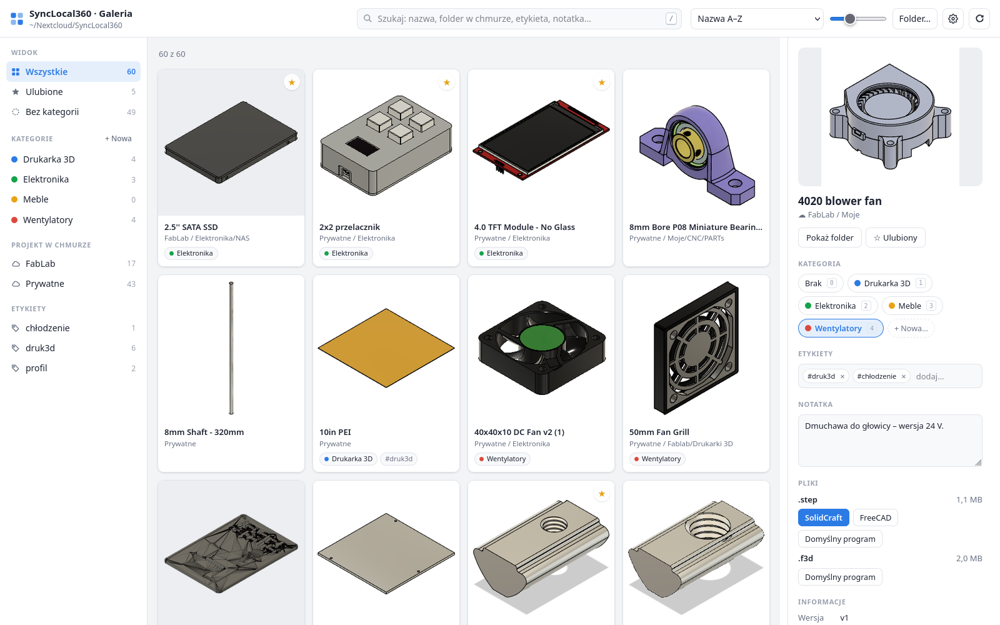
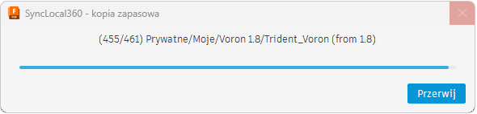
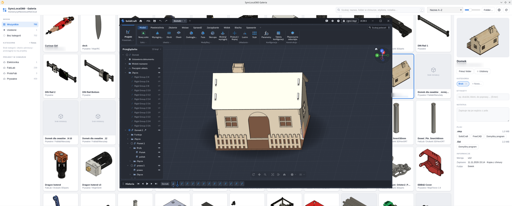
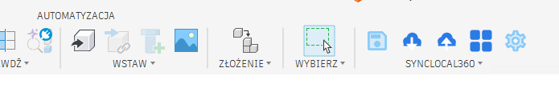
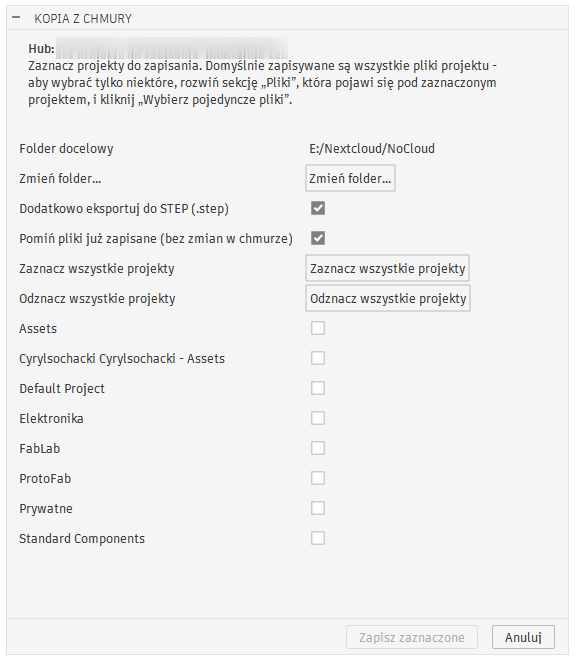
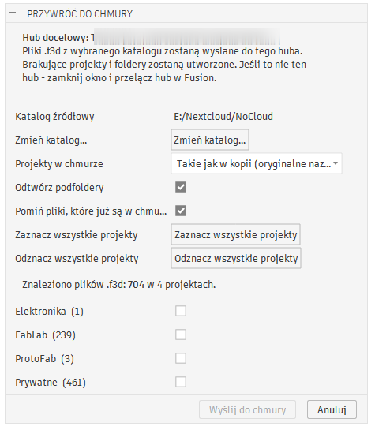
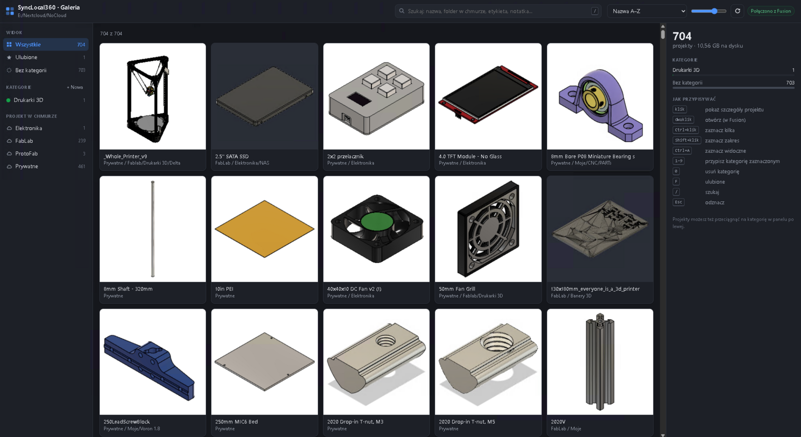
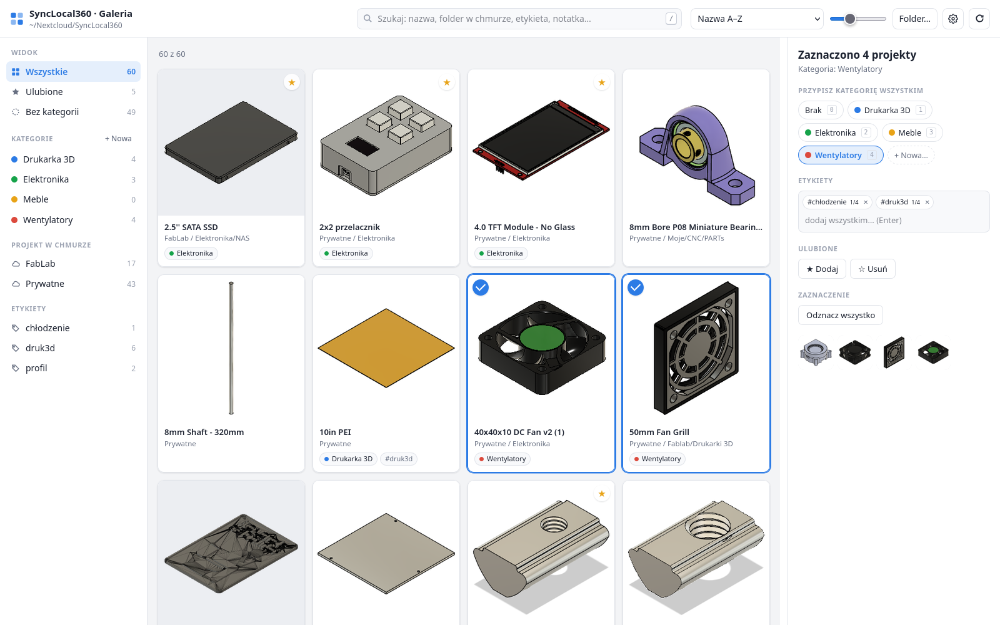
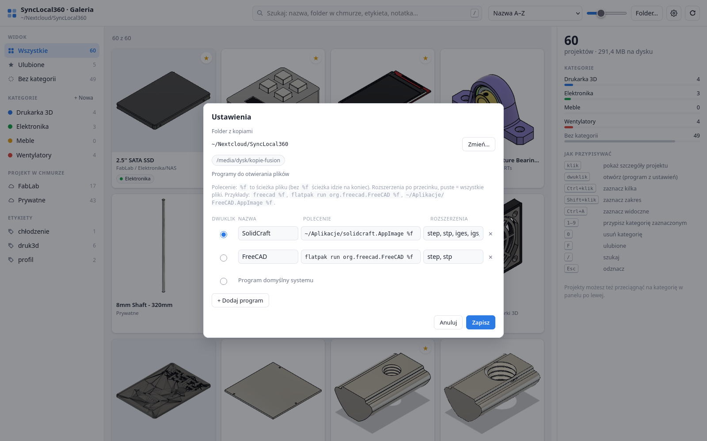

# SyncLocal360

**Zabierz swoje projekty z Fusion 360 na dysk – i na Linuksa.**

SyncLocal360 pomaga wyjść z chmury Autodesk Fusion bez utraty dorobku. Pobiera całą bazę
projektów na Twój dysk (`.f3d` + `.step` + miniatury), pozwala ją uporządkować w galerii
i otwierać modele w programach dostępnych na Linuksie – FreeCAD, SolidCraft i innych.

Projekt jest oparty na dodatku **NoCloud2** autorstwa **Kamila Sokalskiego**
([modelowanie3d.org](https://modelowanie3d.org)) – zob. [Autorzy i licencja](#autorzy-i-licencja).



Projekt składa się z dwóch części:

| Część | Gdzie działa | Do czego |
|---|---|---|
| **Dodatek do Fusion** | Windows / macOS (tam, gdzie jest Fusion) | pobiera projekty z chmury na dysk, eksportuje STEP, przywraca kopie do chmury |
| **Galeria SyncLocal360** | Linux (AppImage), a także przeglądarka z poziomu Fusion | przegląda kopie, porządkuje je w kategorie, otwiera pliki w wybranych programach |

> SyncLocal360 to niezależny projekt społecznościowy. Nie jest związany z Autodesk ani przez
> Autodesk wspierany. „Autodesk Fusion” i „Fusion 360” są znakami towarowymi Autodesk, Inc.

---

## Spis treści

- [Dla kogo](#dla-kogo)
- [Przejście z Fusion na Linuksa krok po kroku](#przejście-z-fusion-na-linuksa-krok-po-kroku)
- [Dodatek do Fusion](#dodatek-do-fusion)
- [Galeria na Linuksie (AppImage)](#galeria-na-linuksie-appimage)
- [Układ folderu kopii](#układ-folderu-kopii)
- [Ograniczenia – przeczytaj przed migracją](#ograniczenia--przeczytaj-przed-migracją)
- [Częste pytania](#częste-pytania)
- [Budowanie ze źródeł](#budowanie-ze-źródeł)
- [Autorzy i licencja](#autorzy-i-licencja)

## Dla kogo

- Masz kilkaset projektów w chmurze Fusion i chcesz mieć je **u siebie**, w zwykłych plikach.
- Przechodzisz na **Linuksa** i potrzebujesz modeli w formacie, który otworzą tamtejsze programy CAD.
- Zmieniasz konto lub licencję Fusion i chcesz **przenieść projekty** na nowe konto.
- Chcesz po prostu mieć **kopię zapasową** niezależną od chmury.

## Przejście z Fusion na Linuksa krok po kroku

1. **Na komputerze z Fusion** (Windows / macOS) zainstaluj dodatek SyncLocal360
   ([instrukcja niżej](#instalacja)).
2. W **Ustawieniach** dodatku wskaż folder na kopie – najlepiej taki, który synchronizuje się
   z Linuksem (Nextcloud, Syncthing, dysk sieciowy) albo który przeniesiesz na dysku USB.
3. Kliknij **Kopia z chmury**, zaznacz projekty i włącz **„Dodatkowo eksportuj do STEP”**.
   To ważne: na Linuksie otworzysz `.step`, a nie `.f3d`.
4. Poczekaj. Kopia idzie plik po pliku, a postęp widać w okienku.
   Duże bazy (setki plików, kilka GB) trwają godzinami – można przerwać i wznowić.

   

5. **Na Linuksie** uruchom Galerię (AppImage), wskaż ten sam folder i gotowe:
   wyszukiwanie, kategorie, etykiety, notatki i otwieranie `.step` w wybranym programie.

   

## Dodatek do Fusion



| Przycisk | Co robi |
|---|---|
| **Szybki Zapis** | zapisuje aktywny projekt na dysk (`.f3d` + miniatura) |
| **Kopia z chmury** | zapisuje zaznaczone projekty lub pojedyncze pliki z chmury (najnowsza wersja, `.f3d`, opcjonalnie `.step`) |
| **Przywróć do chmury** | wgrywa pliki `.f3d` z dysku do chmury, odtwarzając projekty i foldery (np. na nowe konto) |
| **Galeria** | otwiera galerię kopii w przeglądarce (kategorie, etykiety, „Otwórz w Fusion”, „Wstaw do projektu”) |
| **Ustawienia** | folder zapisu, autozapis, wersjonowanie |

<p>
  
  
</p>

Galeria uruchomiona z Fusion (Windows, ciemny motyw):



### Instalacja

1. Pobierz `SyncLocal360_<wersja>.zip` z zakładki [Releases](../../releases) i rozpakuj.
   W środku jest folder `SyncLocal360` – jego nazwa musi tak zostać.
2. W Fusion: **Shift+S → Dodatki → „+”** → wskaż folder `SyncLocal360` → **Uruchom**
   (opcjonalnie „Uruchamiaj przy starcie”).
3. Na karcie **Bryła** pojawi się panel **SyncLocal360**.

Aktualizacja: rozpakuj nową wersję na starą i w Fusion zrób **Stop → Uruchom**.
Twoje ustawienia zostają.

### Kopia z chmury – szczegóły

- Zapisuje **najnowszą wersję** każdego pliku. Pliki otwierają się w tle, a te, które
  miałeś już otwarte, nie są zamykane.
- **„Pomiń pliki już zapisane”** – pobiera tylko nowe i zmienione pliki. Dzięki temu po
  przerwaniu (albo awarii Fusion) wystarczy uruchomić kopię jeszcze raz. Brakujący `.step`
  lub brakująca miniatura są dociągane bez ponownego zapisu `.f3d`.
- Pod każdym projektem można rozwinąć **„Pliki: …”** i wybrać pojedyncze pliki.
- Log `backup_log_<data>.txt` w folderze docelowym jest dopisywany na bieżąco.
- Miniatura pochodzi z chmury Fusion. Nazwy z polskimi znakami są obsługiwane.
- „Standard Components” to biblioteka części Autodesku, nie Twój projekt – jest na końcu
  listy i „Zaznacz wszystkie” go pomija.

### Przywróć do chmury

Wskaż katalog z kopią, wybierz tryb (**projekty jak w kopii** albo **wszystko do jednego
projektu**), zaznacz pliki i kliknij **Wyślij do chmury**. Brakujące projekty i foldery
zostaną założone, a pliki o tej samej nazwie – pominięte.

> **Funkcja eksperymentalna.** Przywracanie nie zostało jeszcze sprawdzone na dużej bazie.
> Przetestuj je najpierw na jednym małym projekcie.

## Galeria na Linuksie (AppImage)

Samodzielna aplikacja – nie potrzebuje Fusion ani przeglądarki.

1. Pobierz `SyncLocal360 Galeria_<wersja>_amd64.AppImage` z [Releases](../../releases).
2. `chmod +x SyncLocal360*.AppImage` i uruchom (albo „Właściwości → Uprawnienia → Wykonywanie”).
3. Kliknij **Folder…** i wskaż folder z kopiami.

Co potrafi:

- **Szukanie** po nazwie, folderze w chmurze, etykietach i notatkach (klawisz `/`).
- **Kategorie** z kolorami, **etykiety**, **notatki**, **ulubione**.
- **Porządkowanie wielu projektów naraz**: Ctrl/Shift+klik, potem klawisz **1–9**
  przypisuje kategorię, **0** ją usuwa – albo przeciągnij projekty na kategorię.

  

- **Otwieranie plików w wybranych programach.** W ustawieniach (zębatka) dodajesz programy
  i decydujesz, który uruchamia się po **dwukliku** na miniaturze.

  

  Przykładowe polecenia (`%f` = ścieżka pliku):

  | Program | Polecenie |
  |---|---|
  | FreeCAD (Flatpak) | `flatpak run org.freecad.FreeCAD %f` |
  | FreeCAD (pakiet) | `freecad %f` |
  | Dowolny AppImage | `~/Aplikacje/Program.AppImage %f` |

  FreeCAD otwierany z wiersza poleceń nie dopasowuje widoku do modelu (modele z Fusion bywają
  niewidoczne albo mocno przybliżone). Galeria sama to naprawia: przekazuje mu małe makro,
  które otwiera plik i ustawia widok izometryczny z „dopasuj wszystko”.

Kategorie i etykiety zapisują się w plikach kopii (`config.json`), więc galeria na Linuksie
i galeria w Fusion widzą to samo – także przez synchronizację folderu.

Galerię można też uruchomić bez budowania aplikacji (wymaga tylko Pythona 3):

```
python3 synclocal_gallery.py ~/Nextcloud/SyncLocal360
```

## Układ folderu kopii

Zwykłe pliki i foldery – nic nie jest zamknięte w bazie danych:

```
<folder kopii>/
  synclocal_gallery.json        lista kategorii (nazwy i kolory)
  backup_log_<data>.txt         logi kopii
  <Nazwa projektu>/
    <Nazwa>.f3d                 archiwum Fusion (pełny projekt z historią)
    <Nazwa>.step                geometria do innych programów CAD
    <Nazwa>.png                 miniatura
    config.json                 opis: projekt i folder w chmurze, wersja, data, kategoria, etykiety, notatka
```

Gdy w chmurze są dwa różne pliki o tej samej nazwie, dostają foldery `<Nazwa>` i `<Nazwa>_1`.

## Ograniczenia – przeczytaj przed migracją

- **`.f3d` otworzy tylko Fusion.** Na Linuksie pracujesz na `.step`.
- **STEP to sama geometria** – bez historii operacji, parametrów, szkiców i ograniczeń z Fusion.
  W FreeCAD i innych programach model jest „bryłą”, którą można dalej obrabiać, ale nie
  edytować tak jak w Fusion. Zachowaj `.f3d` na wypadek powrotu do Fusion.
- **Do pobrania potrzebny jest Fusion** (Windows lub macOS, dowolna licencja z dostępem do
  chmury). Dodatek działa w ramach Fusion i jego API – na Linuksie samego Fusion nie ma.
- Kopia i przywracanie działają na **aktywnym hubie** (zespole) w Fusion. Przy kilku hubach
  przełącz hub i powtórz kopię.
- Zapisywana jest tylko **najnowsza wersja** każdego pliku, bez historii wersji z chmury.
- Rysunki techniczne (`.f2d`), symulacje i pliki elektroniki nie są obsługiwane – tylko projekty 3D.
- Galeria na Linuksie była testowana na Debianie z KDE; AppImage powinien działać na
  współczesnych dystrybucjach x86-64.

## Częste pytania

**Ile to trwa?** Każdy plik jest otwierany i eksportowany przez Fusion, więc zależy od
rozmiaru modeli. Przykładowo ok. 700 plików (ok. 11 GB razem ze STEP) zajęło kilka godzin.

**Fusion się zawiesił w trakcie kopii.** Uruchom go ponownie i puść kopię jeszcze raz
z zaznaczonym „Pomiń pliki już zapisane”. Każdy plik jest zapisywany od razu, więc nic
nie przepadnie.

**Niektóre projekty nie mają miniatury.** Kopia z „Pomiń” dociągnie brakujące miniatury.
Jeśli folder synchronizujesz (np. Nextcloud), sprawdź też, czy klient wysłał pliki `.png`.

**Czy mogę wrócić do Fusion?** Tak – `.f3d` zawiera cały projekt. „Przywróć do chmury”
wgra kopie z powrotem, także na inne konto.

## Budowanie ze źródeł

Paczka dodatku dla Fusion (powstaje `dist/SyncLocal360_<wersja>.zip`):

```
python3 tools/build_fusion_zip.py
```

Aplikacja na Linuksa (Tauri 2 + Rust) – szczegóły w [linux/README.md](linux/README.md):

```
sudo apt install libwebkit2gtk-4.1-dev libgtk-3-dev librsvg2-dev \
  libayatana-appindicator3-dev patchelf build-essential file
cd linux && npm install && npm run build
```

Galeria w Fusion i aplikacja na Linuksa używają tej samej strony:
[`resources/gallery/index.html`](resources/gallery/index.html).

## Autorzy i licencja

- **Cyryl Sochacki** – SyncLocal360 (kopia z chmury, przywracanie, galeria, aplikacja na Linuksa).
- **Kamil Sokalski** – autor oryginalnego dodatku **NoCloud2**
  ([modelowanie3d.org](https://modelowanie3d.org)), na którym SyncLocal360 jest oparty.

NoCloud2 został udostępniony na licencji otwartej z wymogiem uznania autorstwa.
Z oryginału pochodzą m.in. Szybki Zapis, ustawienia, autozapis, format folderu kopii
(`config.json`) i ikony Szybkiego Zapisu i Ustawień. Dokładny spis: [NOTICE.md](NOTICE.md).
Korzystając z kodu SyncLocal360, zachowaj informację o obu autorach.
